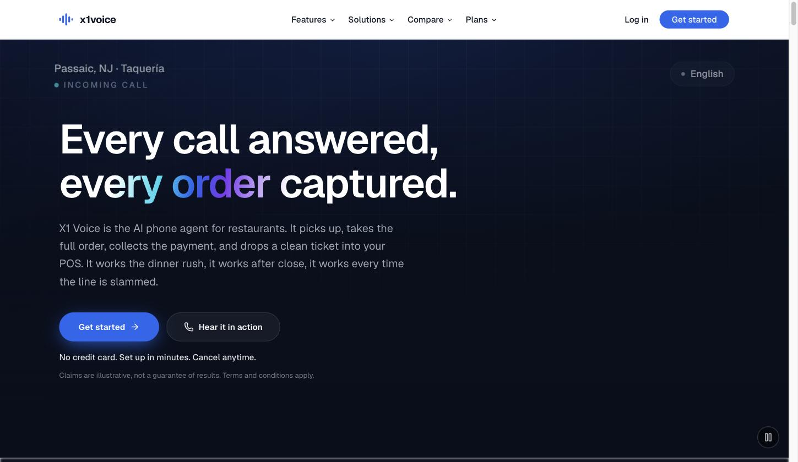
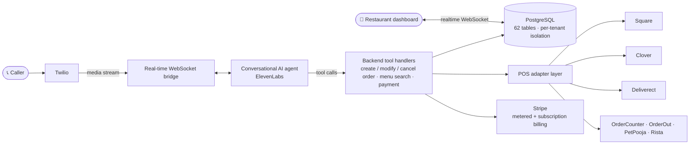

# X1 Voice

**AI phone agent for restaurants.** X1 Voice answers a restaurant's phone, takes the full order in natural conversation, collects payment, and drops a clean ticket into the point-of-sale — during the dinner rush, after close, and every time the line is slammed.

🔗 **Live:** [x1voice.com](https://x1voice.com) · Deployed to real restaurants handling live customer calls.

> This repository is a technical overview of a production system I designed, built, and operate, leading a team of three other engineers. The application source is private (it's a live business); this page documents the architecture and engineering. For a walkthrough or code sample, [reach out](https://linkedin.com/in/aebogush).



---

## What it does

A caller dials the restaurant. X1 Voice picks up, understands the menu, takes and modifies the order, answers questions, collects payment over the phone, and routes the finished order into whichever POS the restaurant already uses — all without a human.

## Architecture



## Engineering highlights

- **Multi-tenant backend** — a 291-endpoint Express/TypeScript API over a **62-table PostgreSQL** schema (Drizzle ORM) with strict per-tenant data isolation enforced on every query, Redis-backed sessions and rate limiting.
- **Real-time voice pipeline** — bridges Twilio telephony to an ElevenLabs conversational agent over WebSockets, with backend tool handlers (order create/modify/cancel, menu search, payment) and a fuzzy-matching resolver that maps spoken menu items to structured data.
- **POS integration framework** — an adapter pattern with bi-directional menu sync and order routing across **7 providers** (Square, Clover, Deliverect, OrderCounter, OrderOut, PetPooja, Rista), plus OAuth flows, external-ID mapping, and per-provider sync logging.
- **Usage-based billing** — Stripe metered + subscription billing with idempotent usage reporting and signed-webhook processing; SMS payment-link flow over Twilio (A2P 10DLC compliant).
- **Tested & operated** — ~10,700 automated tests across 400+ test files; ~1,070 commits, deployed on AWS.

## The adapter contract

Every POS is different, so order routing sits behind one interface — adding a provider means implementing it, not touching the call flow:

```typescript
interface PosAdapter {
  syncMenu(tenantId: string): Promise<MenuSyncResult>;
  pushOrder(tenantId: string, order: Order): Promise<PosOrderRef>;
  cancelOrder(tenantId: string, ref: PosOrderRef): Promise<void>;
  resolveExternalId(tenantId: string, localId: string): Promise<string>;
}
```
*Illustrative — the production adapters add provider-specific auth, retries, and sync logging.*

## Stack

**Backend** TypeScript · Node.js · Express · PostgreSQL · Drizzle ORM · Redis · WebSockets
**Frontend** React · Vite · Tailwind CSS (restaurant / sales / admin portals)
**Integrations** Twilio · ElevenLabs · Stripe · Square · Clover · Deliverect · OrderCounter · OrderOut
**Infra** AWS · Docker · Caddy

---

Built by [Alex Bogush](https://linkedin.com/in/aebogush) · abogush@colgate.edu
